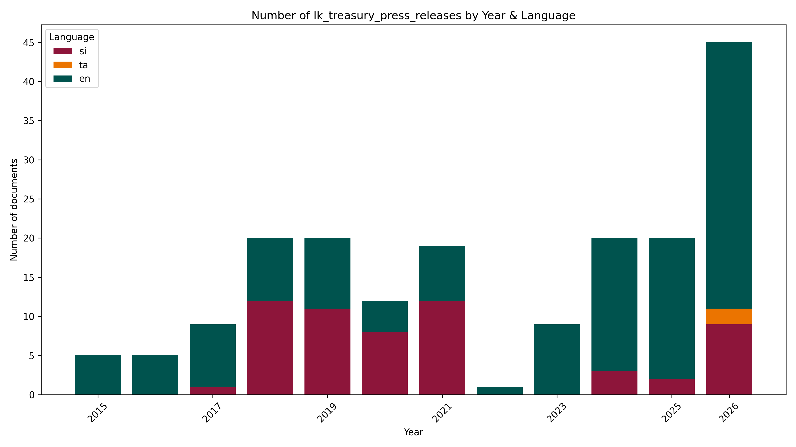

# 💰#SriLanka 🇱🇰 Treasury Press Releases `Dataset`


[https://github.com/nuuuwan/lk_treasury/tree/data_lk_treasury_press_releases/data/lk_treasury_press_releases](https://github.com/nuuuwan/lk_treasury/tree/data_lk_treasury_press_releases/data/lk_treasury_press_releases)

A Sri Lanka Treasury press release shares key govt financial updates—on budgets, debt, or policy—vital for transparency, guiding investors, citizens, and markets on the nation’s economic direction.

- [**186** documents](https://github.com/nuuuwan/lk_treasury/tree/data_lk_treasury_press_releases/data/lk_treasury_press_releases) (**184.7 MB**), from **2015-09-08** to **2026-11-26**, scraped from [https://www.treasury.gov.lk](https://www.treasury.gov.lk)

- In **JSON**, **PDF** (99%), **TXT** (99%) & **🤗 Hugging Face** (99%)

- In **සිංහල**, **தமிழ்** & **English**

- 🎓 Cite as **[arXiv:2510.04124](https://arxiv.org/abs/2510.04124) [cs.CL]**

## 📝 Example Metadata

```json
{
    "doc_type": "lk_treasury_press_releases",
    "doc_id": "2026-11-26-bd9e72",
    "num": "bd9e72",
    "date_str": "2026-11-26",
    "description": "\u0d9a\u0dca\u0dc2\u0dd4\u0daf\u0dca\u200d\u0dbb, \u0d9a\u0dd4\u0da9\u0dcf \u0dc4\u0dcf \u0db8\u0db0\u0dca\u200d\u0dba \u0db4\u0dbb\u0dd2\u0db8\u0dcf\u0dab \u0dc0\u0dca\u200d\u0dba\u0dc0\u0dc3\u0dcf\u0dba (MSME) \u0dc3\u0db3\u0dc4\u0dcf \u0dc1\u0d9a\u0dca\u0dad\u0dd2\u0db8\u0dad\u0dca \u0dc3\u0dc4 \u0d85\u0db1\u0dca\u0dad\u0dbb\u0dca\u0d9c\u0dca\u200d\u0dbb\u0dc4\u0dab\u0dba\u0d9a\u0dca \u0dc3\u0dc4\u0dd2\u0dad \u0db8\u0dd6\u0dbd\u0dca\u200d\u0dba \u0db4\u0dbb\u0dd2\u0dc3\u0dbb \u0db4\u0daf\u0dca\u0db0\u0dad\u0dd2\u0dba\u0d9a\u0dca \u0d9c\u0ddc\u0da9\u0db1\u0dd0\u0d9c\u0dd3\u0db8\u0dda \u0d86\u0d82\u0dc1\u0dd2\u0d9a \u0dc3\u0d82\u0dc0\u0dbb\u0dca\u0db0\u0db1 \u0dc0\u0dd0\u0da9\u0dc3\u0da7\u0dc4\u0db1 (\u0d8b\u0db4\u0dc0\u0dd0\u0da9\u0dc3\u0da7\u0dc4\u0db1 1) \u0d9a\u0dca\u200d\u0dbb\u0dd2\u0dba\u0dcf\u0dad\u0dca\u0db8\u0d9a \u0d9a\u0dd2\u0dbb\u0dd3\u0db8 \u0dc3\u0db3\u0dc4\u0dcf \u0d86\u0dc3\u0dd2\u0dba\u0dcf\u0db1\u0dd4 \u0dc3\u0d82\u0dc0\u0dbb\u0dca\u0db0\u0db1 \u0db6\u0dd0\u0d82\u0d9a\u0dd4\u0dc0\u0dd9\u0db1\u0dca \u0db8\u0dd6\u0dbd\u0dca\u200d\u0dba \u0dc3\u0dc4\u0dcf\u0dba",
    "url_metadata": "https://www.treasury.gov.lk//web/press-releases/section/2026",
    "lang": "si",
    "url_pdf": "https://www.treasury.gov.lk//api/file/4e173bcc-d746-4f2d-a0fc-11c8ff3ca4a5"
}
```



## 🤗 Hugging Face Datasets


- [nuuuwan/lk-treasury-press-releases-docs](https://huggingface.co/datasets/nuuuwan/lk-treasury-press-releases-docs)
- [nuuuwan/lk-treasury-press-releases-chunks](https://huggingface.co/datasets/nuuuwan/lk-treasury-press-releases-chunks)

## 🆕 20 Latest documents

- 2026-11-26 | `bd9e72` | ක්ෂුද්‍ර, කුඩා හා මධ්‍ය පරිමාණ ව්‍යවසාය (MSME) සඳහා ශක්තිමත් සහ අන්තර්ග්‍රහණයක් සහිත මූල්‍ය පරිසර පද්ධතියක් ගොඩනැගීමේ ආංශික සංවර්ධන වැඩසටහන (උපවැඩසටහන 1) ක්‍රියාත්මක කිරීම සඳහා ආසියානු සංවර්ධන බැංකුවෙන් මූල්‍ය සහාය | [data](https://github.com/nuuuwan/lk_treasury/tree/data_lk_treasury_press_releases/data/lk_treasury_press_releases/2020s/2026/2026-11-26-bd9e72)
- 2026-11-26 | `021871` | Financial Assistance from the Asian Development Bank for the Implementation of  the Building a Strong and Inclusive Financial Ecosystem for Micro, Small and MediumSized Enterprises Sector Development Program (Subprogram 1) | [data](https://github.com/nuuuwan/lk_treasury/tree/data_lk_treasury_press_releases/data/lk_treasury_press_releases/2020s/2026/2026-11-26-021871)
- 2026-11-19 | `3aad11` | ADB Technical Assistance Workshop on Liability Management, Investor Engagement and Sovereign Credit Ratings | [data](https://github.com/nuuuwan/lk_treasury/tree/data_lk_treasury_press_releases/data/lk_treasury_press_releases/2020s/2026/2026-11-19-3aad11)
- 2026-11-06 | `aab4a8` | Financial Assistance from the Asian Development Bank (ADB) for the Implementation of the Water Supply and Sanitation Reform Program – Subprogram 2 | [data](https://github.com/nuuuwan/lk_treasury/tree/data_lk_treasury_press_releases/data/lk_treasury_press_releases/2020s/2026/2026-11-06-aab4a8)
- 2026-11-06 | `65e004` | ජල සම්පාදන හා සනීපාරක්ෂක ප්‍රතිසංස්කරණ වැඩසටහන- උප වැඩසටහන 02 ක්‍රියාත්මක කිරීම සඳහා ආසියානු සංවර්ධන බ ැංකුවෙන් (ADB) මූල්‍ය සහාය | [data](https://github.com/nuuuwan/lk_treasury/tree/data_lk_treasury_press_releases/data/lk_treasury_press_releases/2020s/2026/2026-11-06-65e004)
- 2026-11-05 | `c1675f` | National Single Window for Trade Goes Live from Today | [data](https://github.com/nuuuwan/lk_treasury/tree/data_lk_treasury_press_releases/data/lk_treasury_press_releases/2020s/2026/2026-11-05-c1675f)
- 2026-10-28 | `27b251` | Workshop on Sri Lanka’s National Disaster Risk Financing Strategy | [data](https://github.com/nuuuwan/lk_treasury/tree/data_lk_treasury_press_releases/data/lk_treasury_press_releases/2020s/2026/2026-10-28-27b251)
- 2026-10-16 | `2fbde4` | Pre-Bid Meeting: Domestic Dollar Bond (DDB) 2026 | [data](https://github.com/nuuuwan/lk_treasury/tree/data_lk_treasury_press_releases/data/lk_treasury_press_releases/2020s/2026/2026-10-16-2fbde4)
- 2026-10-12 | `3075bf` | Offer Document | Domestic Dollar Bonds (DDBs) | [data](https://github.com/nuuuwan/lk_treasury/tree/data_lk_treasury_press_releases/data/lk_treasury_press_releases/2020s/2026/2026-10-12-3075bf)
- 2026-10-08 | `bc0bb4` | Financing from the Asian Development Bank (ADB) for the Rooftop Solar Integration and Virtual Net Metering Project with a Grant Component from European Union and the Government of Japan - English | [data](https://github.com/nuuuwan/lk_treasury/tree/data_lk_treasury_press_releases/data/lk_treasury_press_releases/2020s/2026/2026-10-08-bc0bb4)
- 2026-10-08 | `6a341c` | පියැසිපාදක සූර්ය බලශක්තිය එක් කිරීමේ සහ අථත්‍ය ශුද්ධ මනුකරණය පිළිබඳ ව්‍යාපෘතිය සඳහා යුරෝපා සංගමය හා ජපන් රජයේ ප්‍රධාන සංරචකයක් සහිතව ආසියානු සංවර්ධන බැංකුවෙන් (ADB) මූල්‍ය ආධාර ලබා ගැනීම | [data](https://github.com/nuuuwan/lk_treasury/tree/data_lk_treasury_press_releases/data/lk_treasury_press_releases/2020s/2026/2026-10-08-6a341c)
- 2026-10-08 | `4caed4` | Government Securities Trade  Summary E 07.10.2026 | [data](https://github.com/nuuuwan/lk_treasury/tree/data_lk_treasury_press_releases/data/lk_treasury_press_releases/2020s/2026/2026-10-08-4caed4)
- 2026-10-08 | `0c397b` | Government Securities Trade  Summary S 07.10.2026 | [data](https://github.com/nuuuwan/lk_treasury/tree/data_lk_treasury_press_releases/data/lk_treasury_press_releases/2020s/2026/2026-10-08-0c397b)
- 2026-10-05 | `c79636` | මැද පෙරදිග යුද්ධමය වාතාවරණය හේතුවෙන් බලපෑමට ලක් වූ ජනතාවට තවදුරටත් සහන සැලසීමේ වැඩසටහන | [data](https://github.com/nuuuwan/lk_treasury/tree/data_lk_treasury_press_releases/data/lk_treasury_press_releases/2020s/2026/2026-10-05-c79636)
- 2026-10-05 | `4aa2b6` | மத்திய கிழக்கில் நிலவும் போர்ச் சூழலால் பாதிக்கப்பட்ட மக்களுக்கு நிவாரணம் வழங்கும் நிகழ்ச்சித்திட்டத்தைத் தொடர்ந்து முன்னெடுத்தல் | [data](https://github.com/nuuuwan/lk_treasury/tree/data_lk_treasury_press_releases/data/lk_treasury_press_releases/2020s/2026/2026-10-05-4aa2b6)
- 2026-10-05 | `0261d5` | Continuation of the Programme for Provision of Relief to People Affected by the War Situation in the Middle East -English | [data](https://github.com/nuuuwan/lk_treasury/tree/data_lk_treasury_press_releases/data/lk_treasury_press_releases/2020s/2026/2026-10-05-0261d5)
- 2026-10-02 | `9deefc` | IRD implemented the facilitation of Web API integration with RAMIS by publishing the guidelines for VAT return filing. | [data](https://github.com/nuuuwan/lk_treasury/tree/data_lk_treasury_press_releases/data/lk_treasury_press_releases/2020s/2026/2026-10-02-9deefc)
- 2026-09-22 | `2a26a1` | Fitch Ratings Upgrades Sri Lanka to ‘B-‘with a Stable Outlook | [data](https://github.com/nuuuwan/lk_treasury/tree/data_lk_treasury_press_releases/data/lk_treasury_press_releases/2020s/2026/2026-09-22-2a26a1)
- 2026-09-10 | `0eaec3` | Sri Lanka Strengthens Institutional Capacity in Sovereign Risk and Debt Sustainability Analysis | [data](https://github.com/nuuuwan/lk_treasury/tree/data_lk_treasury_press_releases/data/lk_treasury_press_releases/2020s/2026/2026-09-10-0eaec3)
- 2026-09-09 | `677047` | දේශීය ආදායම් දෙපාර්තමේන්තුව විසින් අනුකූලතා අවශ්‍යතා සපුරන ලද VAT ආපසු ගෙවීම් ඉල්ලීම්වලින් 99.98% ක්, දින 29 ක සාමාන්‍යයක් තුළ සාර්ථකව නිකුත් කරයි | [data](https://github.com/nuuuwan/lk_treasury/tree/data_lk_treasury_press_releases/data/lk_treasury_press_releases/2020s/2026/2026-09-09-677047)

---

### [More Datasets about 🇱🇰 #SriLanka](https://github.com/nuuuwan/lk_datasets)


[](https://opensource.org/licenses/MIT)
